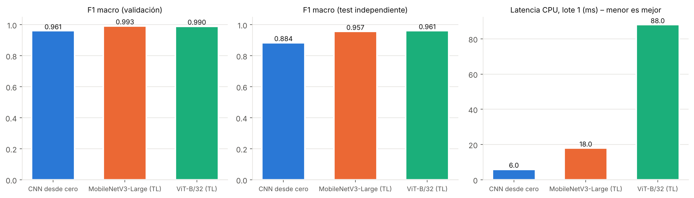
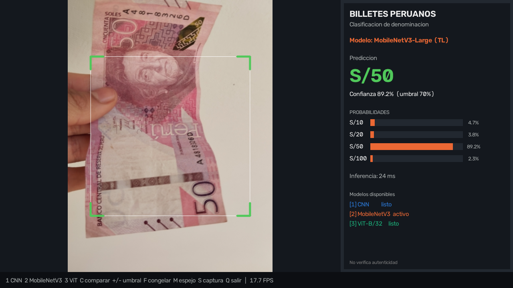

# Reconocimiento de billetes peruanos con cámara web
### CNN desde cero vs. Transferencia de aprendizaje (MobileNetV3) vs. Vision Transformer (ViT-B/32)

Proyecto de la primera unidad — Visión Artificial, X ciclo, grupo B · Ingeniería de Sistemas, Universidad Nacional del Altiplano Puno.

Aplicación que clasifica en tiempo real, desde la cámara web, la **denominación** de un billete peruano
(**S/10, S/20, S/50, S/100**). Se entrenaron y compararon tres modelos con enfoques distintos:

| # | Enfoque | Modelo | Idea |
|---|---|---|---|
| 1 | End-to-end con CNN | `BilletesCNN` (8 capas conv., 1.17 M parám.) | todos los pesos se aprenden desde cero |
| 2 | Transferencia de aprendizaje | MobileNetV3-Large (ImageNet-1k) + **capas finales nuevas** (1280→256→4) | backbone congelado → ajuste fino de los últimos bloques |
| 3 | Vision Transformer | ViT-B/32 (ImageNet-21k, Dosovitskiy et al. 2021) + cabeza lineal | *linear probing* → ajuste fino de los últimos 4 bloques Transformer |

> ⚠️ Clasifica la denominación; **no** verifica si un billete es auténtico.

## Resultados (test independiente de 261 fotos, CPU Intel Xeon 2.8 GHz, 2 hilos)

| Modelo | Parám. | GFLOPs | Tamaño | Latencia CPU | F1 macro val | Exactitud test | F1 macro test |
|---|---|---|---|---|---|---|---|
| CNN desde cero | 1.17 M | 0.42 | 4.7 MB | 6 ms | 0.961 | 0.881 | 0.884 |
| **MobileNetV3-Large (TL)** ← app | 4.53 M | 0.43 | 18.3 MB | 18 ms | **0.993** | **0.962** | 0.957 |
| ViT-B/32 (TL) | 87.5 M | 8.72 | 349.9 MB | 88 ms | 0.990 | **0.962** | **0.961** |

* Transferencia de aprendizaje ≫ CNN desde cero (McNemar p < 0.001). MobileNetV3 y ViT empatan (p = 1.00).
* **Modelo de la app: MobileNetV3-Large** — mayor F1 en validación; ViT está a <1 punto pero es 5× más lento y 19× más pesado.
* Con umbral 0.70, MobileNetV3 responde al 90 % de las fotos de test con 99.2 % de exactitud (el resto: «INCIERTO»).
* Tiempos de entrenamiento en CPU: CNN 77 min · MobileNetV3 51 min · ViT 76 min.
* Detalle: `runs/comparacion.md`, `runs/metricas_detalle.json`, figuras en `runs/` (en inglés: `runs/figures_en/`).





---

## 1. Estructura

```
proyecto.py               CLI: inspect | prepare | train | evaluate | explain | predict | webcam
app_webcam.py             aplicación de cámara web (OpenCV)
billetes/
  datos.py                preparación del dataset, aumentos de datos, DataLoaders
  modelos.py              CNN, MobileNetV3 + capas finales, ViT-B/32; carga de pesos preentrenados
  entrenar.py             entrenamiento por fases, early stopping, curvas
  evaluar.py              métricas, matrices de confusión, latencia, GFLOPs, robustez, selección
  explicar.py             Grad-CAM (CNN/MobileNet) y Attention Rollout (ViT)
  inferencia.py           Predictor reutilizable
datos/testing_set_labels.csv   etiquetas manuales de las 261 imágenes del testing_set oficial
herramientas/figuras_dataset.py figuras del dataset para la exposición
notebooks/entrenamiento_colab.ipynb  entrenamiento completo en Google Colab (GPU)
runs/                     checkpoints (*.pt), historiales, gráficos y comparacion.md
```

## 2. Instalación (Windows PowerShell)

```powershell
py -m venv .venv
.\.venv\Scripts\Activate.ps1
pip install -r requirements.txt
python -c "import torch; print(torch.__version__, torch.cuda.is_available())"
```
Con GPU NVIDIA instala PyTorch con CUDA desde https://pytorch.org/get-started/locally/ (el `pip install torch` por defecto en Windows es solo CPU).

## 3. Dataset

*Peruvian Banknotes* (Caytuiro-Silva et al., 2023, *Data in Brief* 51, 109715), CC BY 4.0, 9 315 imágenes en 16 subcategorías
(denominación × anverso/reverso × serie antigua/nueva) que se agrupan en 4 clases.

```powershell
git clone --depth 1 https://github.com/NicolasPCS/Dataset-Billetes-Peruanos D:\datasets\billetes
# o descargar el ZIP de https://data.mendeley.com/datasets/22jmt8xhpn/1
```

| Partición | Origen | S/10 | S/20 | S/50 | S/100 | Total |
|---|---|---|---|---|---|---|
| train | `training_set` (fotos planas, muchas recortadas/rotadas) | 1106 | 1281 | 2307 | 1874 | 6568 |
| val | `validation_set` (billete en la mano, fondos variados) | 647 | 775 | 714 | 350 | 2486 |
| test | `testing_set` (sin etiquetas en el original → **etiquetado manual**) | 132 | 65 | 42 | 22 | 261 |

* El `testing_set` oficial no trae etiquetas; se etiquetó imagen por imagen (`datos/testing_set_labels.csv`) para tener una
  **prueba independiente** de escenas que el modelo nunca vio. Revísalo si vas a reportar cifras.
* Se verificó la fuga entre particiones con *hashing* perceptual (dHash, Hamming ≤ 4): 2 imágenes de val y 0 de test tienen
  casi-duplicado en train.

## 4. Uso

```powershell
python proyecto.py prepare --source D:\datasets\billetes            # 4 clases, imágenes a 256 px (≈2 min)
python proyecto.py train --model cnn                                # 1) CNN desde cero
python proyecto.py train --model mobilenet                          # 2) transfer learning
python proyecto.py train --model vit                                # 3) Vision Transformer
python proyecto.py evaluate --robustez                              # tabla comparativa + selección
python proyecto.py explain                                          # Grad-CAM / atención
python proyecto.py webcam                                           # aplicación (usa el modelo seleccionado)
python app_webcam.py --lang en --compare                            # app en inglés, 3 modelos a la vez
python proyecto.py predict --input foto.jpg --model vit             # una imagen o carpeta
```

Opciones útiles: `--epochs`, `--head-epochs`, `--unfreeze N` (bloques a descongelar; `-1` = todos), `--batch`, `--workers 0`
(si Windows da problemas con DataLoader), `--weights archivo.pth` (pesos preentrenados locales, sin internet), `--half`
(checkpoint en float16).

**Sin GPU:** el entrenamiento completo en CPU tarda varias horas (ver tiempos abajo). Usa
`notebooks/entrenamiento_colab.ipynb` en Google Colab (GPU T4 gratuita) y copia la carpeta `runs/` resultante a tu PC.

### Aplicación de cámara web

`python app_webcam.py` (o `python proyecto.py webcam`). Coloca **un** billete dentro del recuadro.

| Tecla | Acción |
|---|---|
| `1` `2` `3` | CNN / MobileNetV3 / ViT |
| `C` | modo comparación: los tres modelos a la vez |
| `+` `-` | sube / baja el umbral de confianza (bajo el umbral → «INCIERTO») |
| `F` / `M` / `S` | congelar cuadro / espejo / guardar captura |
| `Q` / `Esc` | salir |

También acepta un video o una carpeta de imágenes: `python app_webcam.py --camera demo.mp4`.
`--lang en` muestra la interfaz en inglés (para la exposición) y `--compare` arranca en modo comparación.
`demo/demo_comparacion.mp4` es un video de respaldo de la app en modo comparación (por si falla la cámara en la exposición).
Las probabilidades se suavizan en el tiempo (EMA, `--smooth 0.6`) para evitar parpadeos.

## 5. Metodología

**Preprocesamiento.** Cada imagen se reescala a lado menor de 256 px. En evaluación y en la cámara se usa el **mismo**
recorte: cuadrado central → 224 px (128 px en la CNN) → normalización (ImageNet; media/desv. 0.5 en ViT). No se deforma la
imagen (la versión anterior aplastaba fotos 3:4 a 1:1 en entrenamiento pero recortaba en la cámara).

**Aumento de datos** (solo train): rotación 90°/180°/270° (p=0.5) y ±12°, `RandomResizedCrop` (escala 0.30–1), perspectiva,
brillo/contraste/saturación/tono, desenfoque gaussiano y borrado aleatorio (simula dedos). Objetivo: cerrar la brecha entre
las fotos planas de train y los billetes sostenidos en la mano de val/test.

**Desbalance.** Pérdida de entropía cruzada con pesos por clase y *label smoothing* 0.1; métrica principal **F1 macro**.

**Entrenamiento.** AdamW, *warm-up* lineal + coseno, recorte de gradiente 1.0, early stopping sobre F1 macro de validación
(se guarda el mejor checkpoint).

| Modelo | Fase 1 | Fase 2 |
|---|---|---|
| CNN | 35 ép., lr 2e-3, todo el modelo | — |
| MobileNetV3 | 3 ép., solo capas finales (lr 1e-3), backbone congelado con BN en modo eval | 10 ép., últimos 3 bloques + conv_head (lr 1e-4) y capas finales (lr 1e-3) |
| ViT-B/32 | 2 ép., solo cabeza (lr 2e-3) | 5 ép., últimos 4 bloques + norm (lr 3e-5, wd 0.05) y cabeza (lr 1e-3) |

**Selección del modelo final.** Mayor F1 macro en **validación**; si dos modelos están a ≤ 1 punto, gana el de menor latencia
en CPU (la app es en tiempo real). El test independiente se usa solo para reportar. La decisión queda en `runs/seleccion.json`
y la app la carga automáticamente.

## 6. Cambios respecto a la versión inicial del repositorio

| Problema detectado | Solución |
|---|---|
| El `testing_set` oficial se descartaba (no tiene etiquetas) y el test salía de partir `validation_set` al azar: val y test compartían escenas | Se etiquetaron manualmente las 261 imágenes → test independiente; val = `validation_set` completo |
| Entrenamiento con `Resize((224,224))` (deforma fotos 3:4) pero la cámara usaba un recorte cuadrado: distribuciones distintas | Mismo recorte cuadrado central en evaluación y cámara; `RandomResizedCrop` en train |
| Aumento de datos débil frente al cambio de dominio (fotos planas → billete en la mano) | Aumentos fuertes y orientados al problema (rotaciones 90°, oclusión, color, desenfoque) |
| Desbalance (S/50 tiene 2.1× imágenes que S/10) sin tratar | Pesos por clase + label smoothing + F1 macro |
| Transfer learning: solo se cambiaba la última capa y se ajustaba todo desde la época 1 | Capas finales nuevas + 2 fases (extracción de características → fine-tuning) y BN congelada |
| Sin *scheduler*, sin *warm-up*, épocas fijas | Warm-up + coseno, early stopping, recorte de gradiente |
| Sin criterio explícito de selección | Criterio reproducible (`seleccion.json`), elegido en validación |
| Métricas mínimas | + exactitud balanceada, F1 por clase, ECE, cobertura con umbral, GFLOPs, robustez, Grad-CAM/atención |
| Webcam: predicción parpadeante, un modelo a la vez | Suavizado EMA, modo comparación, umbral ajustable, capturas, video/carpeta como fuente |
| Pesos solo desde Hugging Face | Descarga desde GitHub releases de timm con respaldo en Hugging Face o archivo local |

**Nota:** `webcam_mejorada.py` (versión anterior) ahora solo redirige a `app_webcam.py`.

## 7. Limitaciones

* El modelo siempre elige una de las 4 clases; el umbral reduce falsos positivos pero **no** es un detector validado de
  «no es un billete».
* Clasifica un billete a la vez dentro del recuadro (no es un detector de objetos).
* El test tiene 261 imágenes en ráfagas de pocos billetes físicos: los intervalos de confianza son amplios.
* El etiquetado manual del test puede contener errores; verifícalo antes de publicar cifras.

## 8. Referencias

* Caytuiro-Silva, N. E. et al. (2023). Annotated Peruvian banknote dataset for currency recognition and classification. *Data in Brief*, 51, 109715. https://doi.org/10.1016/j.dib.2023.109715
* Dosovitskiy, A. et al. (2021). An image is worth 16x16 words: Transformers for image recognition at scale. *ICLR*.
* Howard, A. et al. (2019). Searching for MobileNetV3. *ICCV*.
* Selvaraju, R. R. et al. (2017). Grad-CAM. *ICCV*. · Abnar, S. & Zuidema, W. (2020). Quantifying attention flow in transformers. *ACL*.
* Wightman, R. (2019). PyTorch Image Models (timm). https://github.com/huggingface/pytorch-image-models
